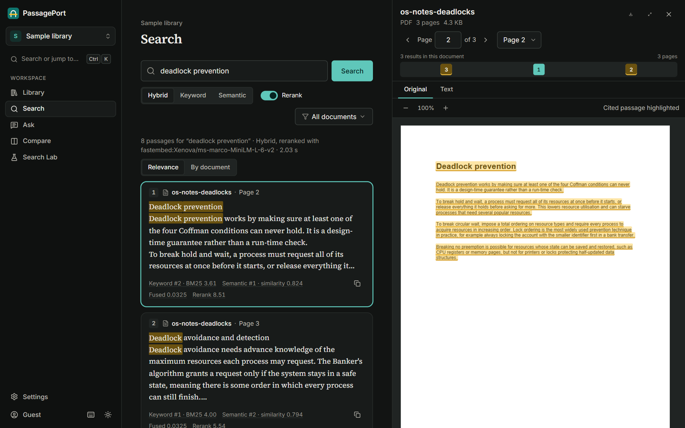
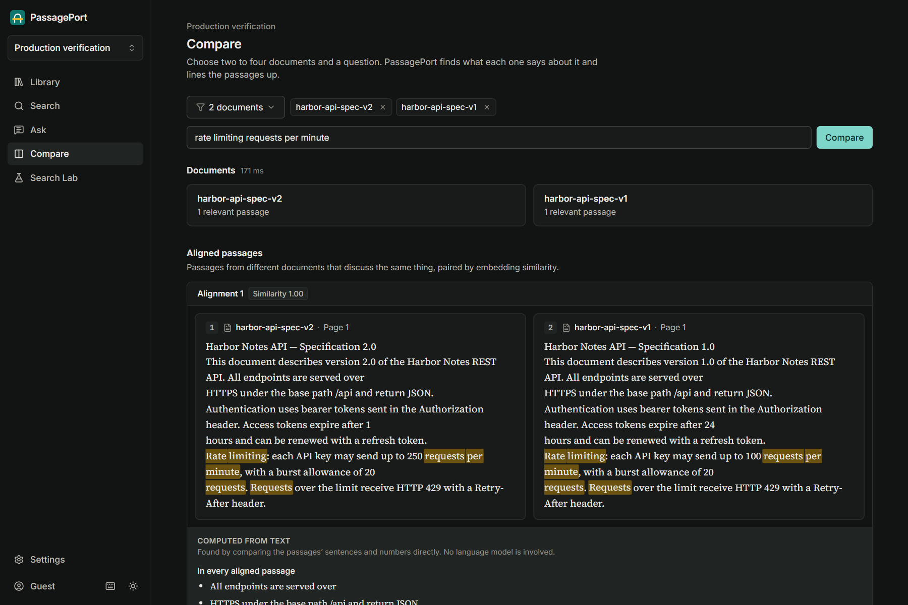
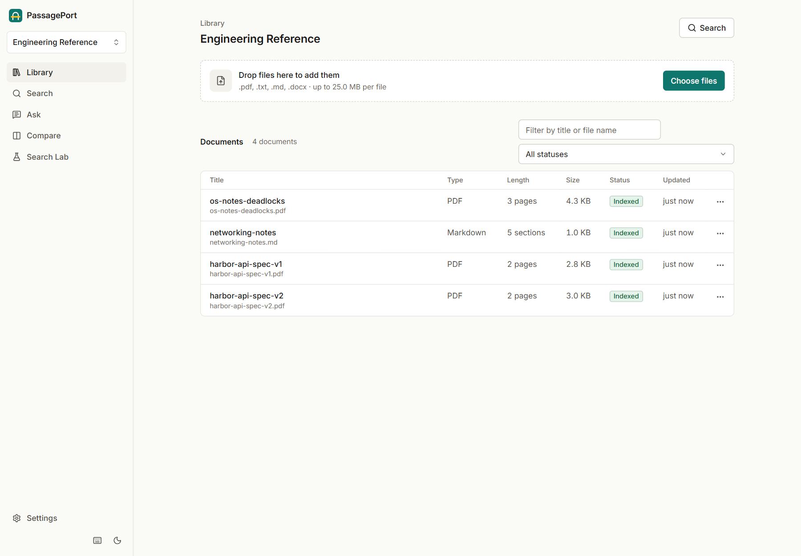
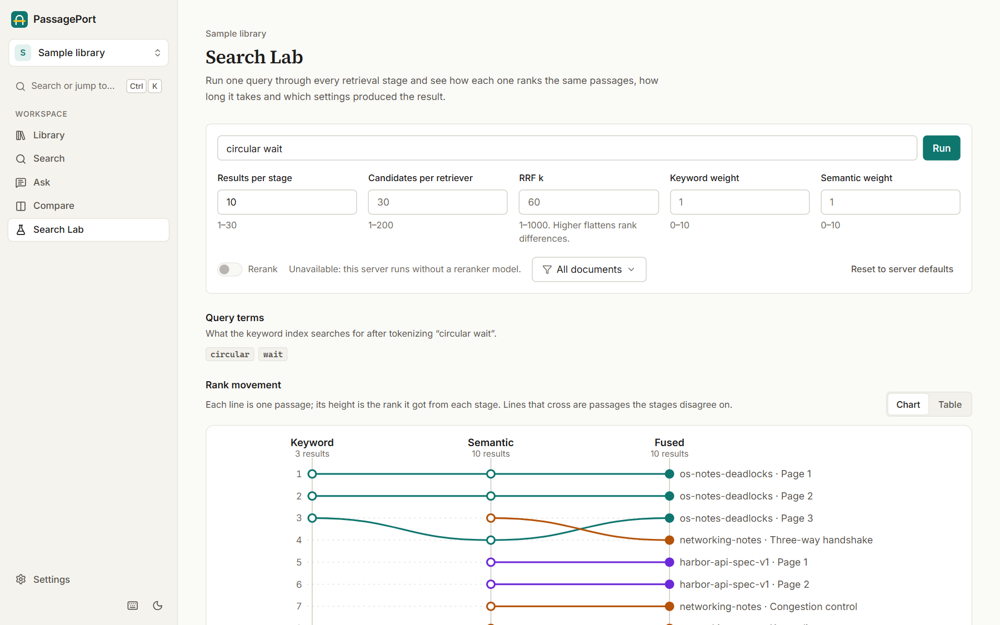
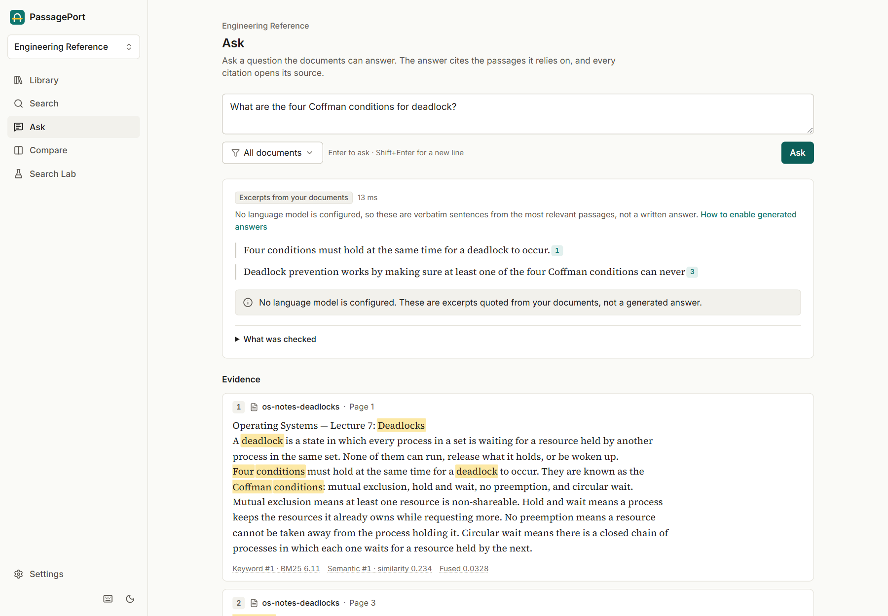
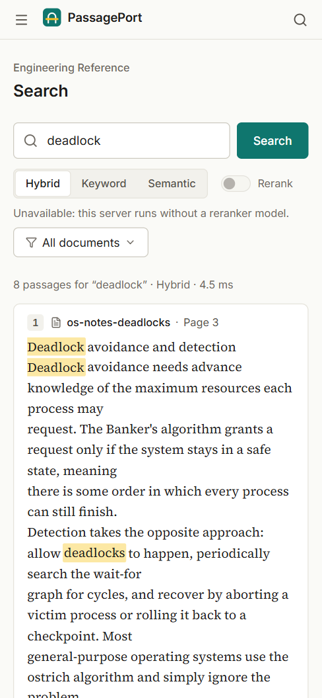
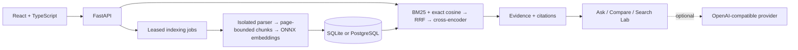

# PassagePort

A document workspace for finding passages, answering questions with citations, and comparing what
different files say. Indexing, search, source viewing and comparison run locally without a paid API key.

[Architecture](docs/ARCHITECTURE.md) · [Technical walkthrough](docs/TECHNICAL_WALKTHROUGH.md) ·
[Security](docs/SECURITY.md) · [Deployment](docs/DEPLOYMENT.md) · [Interview guide](docs/INTERVIEW_GUIDE.md)

## Live demo

**https://passageport.vercel.app** — choose *Continue as guest*. Guest workspaces are deleted after
24 hours. The demo runs the same image as the Docker setup (real ONNX models) on Vercel, with all
data in a Neon PostgreSQL database, so nothing depends on the container's disk. Hobby-plan limits
apply: uploads are capped at 4 MB, and the first request after idle time is slower while the
container starts and loads models.

## Screenshots

| | |
| --- | --- |
|  |  |
| Search, with the cited PDF page and passage highlighted (production). | Two versions of a specification compared: shared text and the numbers that differ (production). |
|  |  |
| Library with real per-document status. | Search Lab: keyword, semantic, fused and reranked rankings with stage latency. |
|  |  |
| Ask: verbatim excerpts with citations, no LLM configured. | Search at phone width. |


## Use it

1. Create a workspace for a course, project or research topic.
2. Upload PDF, Markdown, plain-text or DOCX files. Processing status and failures are shown per file.
3. Search by meaning, exact words, or both. Open a result to see its source page and highlighted text.
4. Ask a question for cited excerpts, or compare two to four documents side by side.
5. Open **Search Lab** to inspect the retrieval stages and their real latency.

Try the original sample documents in [`samples/`](samples/): operating-system notes, networking
notes, and two versions of an API specification. Search “deadlock prevention” or compare the
specifications’ rate limits.

## What it does

| Feature | Behaviour |
| --- | --- |
| Document library | Workspaces, multi-file upload, SHA-256 deduplication, rename, delete, retry and re-index. Original files are kept if indexing fails. |
| Hybrid retrieval | BM25 lexical search + normalized vector similarity, weighted reciprocal-rank fusion, optional cross-encoder reranking, document filters. |
| Source citations | PDF page or text section, exact passage offsets, stable chunk identifiers, original-file download. No invented page numbers. |
| Evidence-backed answers | Without an LLM: verbatim excerpts with citations. With an optional provider: generated answers with citation checks and explicit uncertainty. Retrieved evidence remains visible. |
| Comparison | Independent evidence retrieval per document, passage alignment, shared/unique sentences and numerical changes computed from text. Optional model interpretation is separate. |
| Search Lab | Keyword, vector, fused and reranked lists, measured stage latency, effective configuration and reproducible evaluation results. |
| Access control | Loopback-only local mode, or isolated accounts with Argon2id passwords, server-side sessions and revocable MCP API tokens. |

PDF originals use pdf.js. If the original-page text cannot be matched unambiguously, the viewer
offers the extracted-text view rather than highlighting the wrong passage.

## Quick start: Docker

```bash
git clone https://github.com/tanmay-alpha/PassagePort.git
cd PassagePort
docker compose up --build
```

Open **http://localhost:8000**. The initial build downloads the embedding and reranker models;
subsequent starts use the bundled cache. SQLite and originals live in Compose's
`passageport_passageport-data` volume, not in the disposable container. Do not use
`docker compose down -v` unless
you intend to erase that data.

The default local mode has no login and binds only to loopback. For network access, use accounts
mode behind HTTPS; see [deployment instructions](docs/DEPLOYMENT.md).

## Development

Requirements: Python 3.12+, [uv](https://docs.astral.sh/uv/), Node.js 24.

```bash
# Terminal 1: backend
cd backend
uv sync --frozen --extra dev --extra postgres
uv run uvicorn passageport.main:app --host 127.0.0.1 --port 8000 --reload

# Terminal 2: frontend
cd frontend
npm ci
npm run dev
```

The frontend on http://localhost:5173 proxies `/api` to the backend. Alternatively,
`scripts/dev.ps1` on Windows or `bash scripts/dev.sh` starts both. API documentation is at
**http://localhost:8000/api/docs**.

### Optional generated answers

Configure an OpenAI-compatible chat-completions endpoint in `backend/.env`:

```dotenv
PP_LLM_BASE_URL=http://127.0.0.1:11434/v1
PP_LLM_MODEL=your-installed-local-model
# PP_LLM_API_KEY=...
```

The model must already be installed in your local provider. Nothing is silently substituted.
Only questions and retrieved evidence are sent to the configured endpoint. Generated wording is
**not independently fact-checked**: citation validity and factual correctness are different claims.
See [`.env.example`](.env.example) for all settings.

## Architecture and trade-offs



- **One transactional source of truth.** Documents, pages, chunks and float32 embeddings share
  a SQL store. Re-indexing swaps the whole document index atomically; deletion cascades through it.
- **Versioned cache.** Every chunk mutation increments the collection’s index version. Search
  rebuilds its in-memory BM25 postings and vector matrix when that version changes.
- **CPU-first inference.** Defaults are `BAAI/bge-small-en-v1.5` and a MiniLM cross-encoder through
  fastembed/ONNX Runtime. PyTorch multilingual models are optional, not a mandatory download.
- **Exact, not approximate, vectors.** Intended for personal workspaces. A 50,000 × 384 float32
  matrix alone uses about 77 MB, before text and lexical-index overhead. This is not a claim of
  million-document scale.
- **Crash recovery.** Jobs have renewable leases and attempt fencing. Failed re-indexing keeps
  the previous index; files are not discarded.

Model choices, retrieval metrics, datasets, limitations and reproduce commands are documented in
[Search evaluation](docs/SEARCH_EVALUATION.md). Benchmark numbers are generated by
`python -m passageport.evaluation.run`, never hardcoded search responses.

## Measured results

Copied from [`eval/results/default.json`](eval/results/default.json) (CPU-only; `bge-small-en-v1.5`
embeddings + `ms-marco-MiniLM-L-6-v2` cross-encoder). Latency is p50 per query on a shared
developer workstation, excluding model load.

| Corpus | Run | Recall@1 | Recall@5 | Recall@10 | MRR@10 | nDCG@10 | p50 ms |
| --- | --- | ---: | ---: | ---: | ---: | ---: | ---: |
| mini | keyword | 0.6293 | 0.7414 | 0.7759 | 0.6783 | 0.7017 | 0.67 |
| mini | semantic | 0.5603 | 0.7759 | 0.8621 | 0.6521 | 0.7017 | 5.59 |
| mini | hybrid | 0.5948 | 0.8448 | 0.8621 | 0.6977 | 0.7383 | 5.29 |
| mini | hybrid+rerank | 0.7155 | 0.8276 | 0.9138 | 0.771 | 0.8044 | 598.12 |
| scifact | keyword | 0.6 | 0.79 | 0.834 | 0.7009 | 0.7312 | 1.1 |
| scifact | semantic | 0.729 | 0.851 | 0.886 | 0.8064 | 0.8188 | 8.51 |
| scifact | hybrid | 0.669 | 0.838 | 0.913 | 0.7872 | 0.8076 | 9.57 |
| scifact | hybrid+rerank | 0.615 | 0.863 | 0.926 | 0.7498 | 0.7913 | 616.17 |

- **mini** is a small self-authored corpus (14 documents, 58 answerable questions) whose questions
  and labels were written together with it, so its numbers are indicative, not an independent test.
- **scifact** is a deterministic 50-query subset of the BEIR SciFact test set over all 5,183
  abstracts, not a full-test-set result; there, reranking raises Recall@5/@10 but lowers
  Recall@1 and MRR versus vector-only or hybrid search, so reranking can be disabled.

Method, caveats and reproduce commands: [Search evaluation](docs/SEARCH_EVALUATION.md).

## Verification commands

```bash
# Backend: deterministic test embedder, no model downloads
cd backend
uv run ruff check .
uv run ruff format --check .
uv run mypy passageport
uv run pytest

# Web client
cd ../frontend
npm ci
npm run lint
npm run typecheck
npm test -- --run
npm run build

# Real browser workflows (build frontend and sync backend first)
cd ../e2e
npm ci
npx playwright install chromium firefox
npx playwright test

# MCP integration
cd ../mcp-server
npm ci
npm run typecheck
npm test
npm run build
```

The browser suite uses the real parser, database, job worker, API and UI, with a deterministic
test embedder. Real-model evaluation is separate: passing UI tests does not establish semantic
retrieval quality. [CI](https://github.com/tanmay-alpha/PassagePort/actions/workflows/ci.yml)
also checks PostgreSQL, Docker and dependency advisories.

## MCP

The TypeScript stdio server exposes `list_collections`, `list_documents`, `search`, `get_passage`,
`get_page` and `ask`. Set `PASSAGEPORT_API_URL` and, in accounts mode, a personal
`PASSAGEPORT_API_TOKEN`. See [MCP setup](mcp-server/README.md).

## Privacy and limitations

- Local mode is single-user; accounts mode checks ownership on every document and retrieval path.
- Uploaded files and the database are not application-encrypted at rest. Use encrypted disks and
  managed storage appropriate to your documents.
- Scanned PDFs need OCR, which is not included. Encrypted or image-only PDFs fail explicitly.
- Parser processes have deadlines and limits, not a complete hostile-code sandbox.
- Rate limits are per process. Public deployments need operational abuse controls and backups.
- Hosted storage must be persistent. A free service’s ephemeral disk is **not** durable hosting.

## Attribution and original contribution

PassagePort began from [Praveen Chamarthi’s Simple Knowledge Base](https://github.com/praveenc/simple-knowledge-base),
MIT, commit `a0d8c06`. Its commit history and copyright notice are preserved.

Retained foundations: FastAPI, React/Vite/TypeScript, semchunk, the retrieve-then-rerank pattern,
and the MCP integration concept. The original models remain optional.

PassagePort’s additions are the document/page lifecycle and citation model, transactional
persistence, hybrid retrieval, evidence-backed answers, independently computed document
comparison, Search Lab/evaluation harness, account isolation, leased indexing, redesigned UI and
release/testing infrastructure. This is a derived project with substantial new engineering—not
a claim to have invented semantic search or written the upstream prototype.

See [baseline audit](docs/BASELINE_AUDIT.md), [NOTICE](NOTICE.md) and [MIT license](LICENSE).

