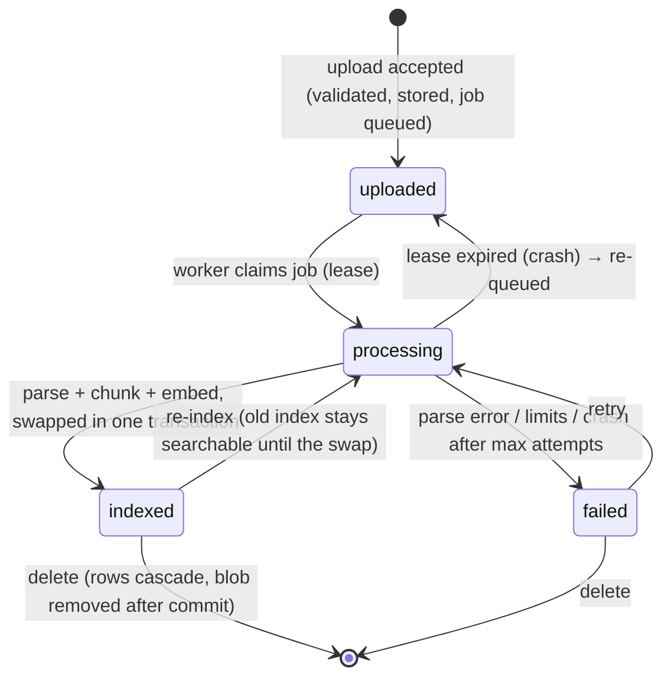

# Architecture

PassagePort is a single deployable unit: one FastAPI process that serves the JSON API, the built
React app, the indexing worker and the in-memory search indexes, on top of one SQL database.

```mermaid
flowchart LR
  subgraph Browser
    UI[React SPA<br/>library · search · ask · compare · lab · viewer]
  end
  subgraph Server[FastAPI process]
    MW[Middleware<br/>host guard · CSRF · security headers]
    API[Routers<br/>auth · collections · documents<br/>search · ask · compare · lab]
    ING[Ingestion<br/>validate → parse (subprocess) → chunk → embed]
    Q[(Job queue<br/>leases + heartbeat)]
    IDX[Index cache<br/>BM25 postings + embedding matrix<br/>per collection, version-keyed]
    RET[Retrieval<br/>keyword · semantic · RRF fusion · rerank]
    ANS[Answers / Compare<br/>extractive or optional LLM]
  end
  DB[(SQL: SQLite or PostgreSQL<br/>users · sessions · collections · documents<br/>pages · chunks + embeddings · jobs)]
  BLOB[(Original files<br/>filesystem or SQL blobs)]
  M[ONNX models<br/>bge-small-en-v1.5 · MiniLM cross-encoder]
  LLM[[Optional OpenAI-compatible LLM]]

  UI -->|/api, same origin| MW --> API
  API --> ING --> Q
  Q --> ING
  ING --> DB
  ING --> BLOB
  ING --> M
  API --> RET --> IDX --> DB
  RET --> M
  API --> ANS --> RET
  ANS -.-> LLM
```

## Components

| Concern | Module | Notes |
| --- | --- | --- |
| API + validation | `passageport/api/` | Typed Pydantic schemas in `api/schemas.py` are the contract. One DB transaction per request. Errors are always `{"error": {"code", "message"}}`. |
| Auth | `passageport/auth/` | `local` (single user, loopback hosts only) or `accounts` (argon2id, hashed server-side sessions, per-user isolation, API tokens). |
| Upload validation + blobs | `passageport/storage/` | Size cap while streaming, extension + content sniffing, zip-bomb guard, sha256 dedup, server-generated blob keys. |
| Parsing | `passageport/parsing/` | PDF (pypdf), TXT, Markdown, DOCX → ordered "pages". Runs in a killable subprocess with a timeout. |
| Chunking | `passageport/chunking.py` | `semchunk`, token-bounded, never crosses a page; exact character offsets; deterministic chunk IDs. |
| Embeddings / reranker | `passageport/ml/` | `Embedder` / `Reranker` protocols. Backends: fastembed (default, ONNX), sentence-transformers (optional), hashing (tests). |
| Jobs | `passageport/ingest/` | DB-backed queue with leases and heartbeats; worker thread; crash recovery by lease expiry. |
| Lexical search | `passageport/search/bm25.py` | BM25 with a tokenizer tuned for technical text. |
| Vector search | `passageport/search/index.py` | Exact cosine over a per-collection matrix. |
| Hybrid retrieval | `passageport/search/` | Weighted reciprocal-rank fusion, optional cross-encoder rerank, confidence gating. |
| Answers | `passageport/answer/` | Extractive by default; optional LLM with citation validation and prompt-injection defenses. |
| Compare | `passageport/compare/` | Per-document retrieval, embedding alignment, text-computed diffs; optional labelled LLM interpretation. |
| Search Lab + evaluation | `passageport/lab/`, `passageport/evaluation/`, `eval/` | Stage-by-stage inspection; reproducible Recall@K / MRR / latency harness. |

## Key decisions

**One store instead of SQL + vector DB.** Upstream kept everything in LanceDB tables with no document
records, so a document could not be listed, deleted, re-indexed or cited by page. PassagePort needs
relational metadata anyway. Keeping chunks and their embeddings in the same transactional database
means a delete or re-index is a single transaction and the index can never reference a missing
document. Upstream never built an ANN index, so LanceDB was doing a flat scan; exact cosine over an
in-memory matrix gives the same recall with fewer moving parts. The trade-off is scale: the index for
a collection must fit in RAM (384-d float32 ≈ 1.5 KB per chunk, so 50k chunks ≈ 77 MB). Beyond that,
`search/index.py` is the seam where pgvector or LanceDB would go.

**Version-keyed index cache.** Every transaction that changes chunks bumps
`collections.index_version`. The cache compares that integer (one indexed read) on each query, so it
is correct across restarts and across multiple server processes without any invalidation messages.

**Pages are the citation unit.** Chunks never cross a page and store character offsets into the
stored page text, so `page.text[start:end] == chunk.text` is an invariant (property-tested). A
citation is `(document, page, start, end)`, resolvable until the document is deleted or replaced.

**CPU-first models.** Default models run on ONNX Runtime without PyTorch. See
[SEARCH_EVALUATION.md](SEARCH_EVALUATION.md) for the measured comparison against upstream's models.

**LLM optional, never trusted.** Retrieval, citations and comparison work with no API key. When an
LLM is configured its output is post-validated: citations must point at retrieved passages, uncited
sentences are flagged, and nothing is described as verified unless a check actually ran.

## Data lifecycle



Original files are never deleted because indexing failed. A failed re-index keeps the previous
index and records the error on the document.

## Deployment shapes

- **Local / self-hosted (default):** `docker compose up` — SQLite + files on a volume, bound to
  `127.0.0.1`, no login.
- **Hosted:** `PP_AUTH_MODE=accounts`, PostgreSQL (`PP_DATABASE_URL`) and `PP_BLOB_BACKEND=db` so the
  container itself is stateless. See [DEPLOYMENT.md](DEPLOYMENT.md).
