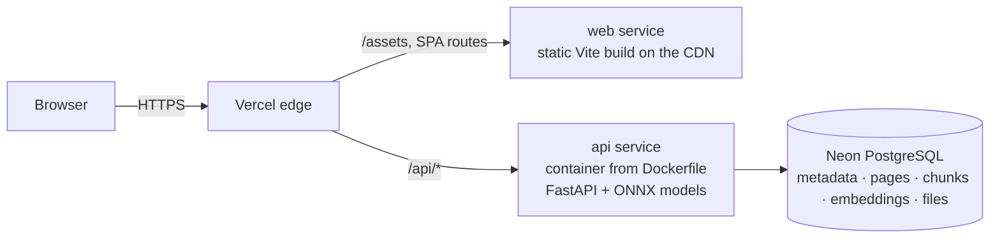

# Deployment

PassagePort runs in two shapes. Both use the same image built from the root `Dockerfile`.

| | Local / self-hosted | Hosted (public) |
| --- | --- | --- |
| Auth | `PP_AUTH_MODE=local`, no login, loopback only | `PP_AUTH_MODE=accounts`, HTTPS |
| Database | SQLite file in `/data` | PostgreSQL (`PP_DATABASE_URL`) |
| Original files | `/data/blobs` | `PP_BLOB_BACKEND=db` (in PostgreSQL) |
| Durable state lives in | the `/data` volume | the database only — the container is stateless |

## 1. Local with Docker

```bash
docker compose up --build        # http://localhost:8000
```

- The port is published on `127.0.0.1` only; local mode has no login.
- Data lives in Compose volume `passageport_passageport-data` (SQLite database + uploaded files).
- The default models are baked into the image, so it starts without network access. Build with
  `PRELOAD_MODELS=0` for a smaller image that downloads them on first use.
- Optional PostgreSQL: `docker compose --profile postgres up` and set `PP_DATABASE_URL` in `.env`
  (see the comments in `docker-compose.yml`).

**Backup and restore.** With the default Compose project name, back up the complete volume while
the app is stopped. Changing `COMPOSE_PROJECT_NAME` also changes the volume name.

```bash
docker compose stop passageport
docker run --rm -v passageport_passageport-data:/data:ro -v "$PWD":/backup alpine \
  tar czf /backup/passageport-backup.tgz -C /data .
docker compose start passageport
```

Restore to a **new, empty volume** first; do not delete a working store to test a backup:

```bash
docker volume create passageport-restored
docker run --rm -v passageport-restored:/data -v "$PWD":/backup:ro alpine \
  tar xzf /backup/passageport-backup.tgz -C /data
```

Point the service's `/data` mount at `passageport-restored`, start it, and check the library,
original downloads and a saved citation before switching over. Keep the previous volume until
the restored instance has been verified.

Embeddings are derived data: if the model changes, documents are flagged *stale* and re-indexed
from the stored originals.

## 2. Local without Docker

```bash
cd backend && uv sync --extra dev
uv run uvicorn passageport.main:app --host 127.0.0.1 --port 8000   # API
cd ../frontend && npm ci && npm run dev                              # UI on http://localhost:5173
```

`make dev` (or `scripts/dev.ps1` on Windows) starts both.

## 3. Hosted demo: Vercel + Neon

The public demo runs entirely on free tiers and keeps its data across restarts and redeploys,
because nothing durable is stored in the container.



`vercel.json` declares two [services](https://vercel.com/docs/services) in one project: `web`
(the Vite build, served from the CDN) and `api` (the container). Because both are behind the same
origin, the session cookie is first-party and no CORS is involved.

Why this and not "Render free tier": a free Render web service has an ephemeral disk, so SQLite
and uploaded files would vanish on every restart. Moving all state into PostgreSQL makes the
compute layer disposable, which is what a scale-to-zero container needs anyway.

### Steps

```bash
vercel link --project passageport
vercel integration add neon --name passageport-db --billing-plan free_v3 --meta region=iad1
# copy the pooled connection string into the variable the app reads (value is never printed)
vercel env pull .env.prod --environment=production
#   PP_DATABASE_URL        = value of DATABASE_URL from .env.prod   (mark as sensitive)
#   PP_AUTH_MODE           = accounts
#   PP_BLOB_BACKEND        = db
#   PP_ALLOW_GUESTS        = true          # "Try it" without creating an account
#   PP_MAX_UPLOAD_MB       = 4             # Vercel caps request bodies at 4.5 MB
#   PP_MAX_DOCUMENTS_PER_USER = 40, PP_MAX_STORAGE_MB_PER_USER = 60
#   PP_MAX_GUESTS = 50, PP_MAX_DATABASE_MB = 400   # server-wide caps; Neon free plan is 0.5 GB
#   PP_MAX_DOCUMENT_CHARS = 1000000, PP_PARSE_TIMEOUT_SECONDS = 60
#   FORWARDED_ALLOW_IPS: leave unset — Vercel's proxy reaches uvicorn from 127.0.0.1 and replaces
#   any client-supplied X-Forwarded-For, so the default trust setting yields the real client IP
#   PP_DATA_DIR            = /tmp/passageport
#   PORT                   = 8000
vercel deploy --prod
```

### Properties and limits of this hosting (measured)

| Property | Value |
| --- | --- |
| Container resources (Vercel Hobby) | 1 vCPU, 2 GB RAM |
| Request body limit | 4.5 MB (a 6 MB upload returns `413 FUNCTION_PAYLOAD_TOO_LARGE`), hence `PP_MAX_UPLOAD_MB=4` |
| Scale to zero | after ~5 minutes idle; the next request cold-starts the container and loads the models |
| Background indexing | the worker thread runs while the instance is alive; a job interrupted by scale-down is re-queued when its lease expires |
| Persistence | PostgreSQL (Neon free plan, 0.5 GB). Verified by redeploying and reading the same documents |
| Backups | Neon point-in-time restore (free plan: limited history) or `pg_dump "$PP_DATABASE_URL"` |

The in-memory search index is rebuilt from PostgreSQL on the first query after a cold start. The
`index_version` check keeps multiple warm instances consistent with each other.

## 4. Other hosts

Any platform that runs a container works:

- **With a persistent disk** (Fly.io volume, Render paid disk, a VPS): mount it at `/data`, keep
  SQLite, set `PP_AUTH_MODE=accounts`, put TLS in front.
- **Without a disk** (Render free, Cloud Run, Koyeb): use PostgreSQL + `PP_BLOB_BACKEND=db`.
  The default real-model image was tested with a 2 GiB memory cap and one CPU. A 512 MB host
  has not been validated and is not a supported capacity claim; measure before choosing it.

Behind a reverse proxy set `FORWARDED_ALLOW_IPS` to the proxy's address so client IPs used by the
login throttle are correct.

## Environment reference

Every setting is documented in [`.env.example`](../.env.example).
