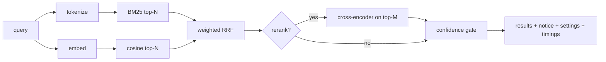

# Technical walkthrough

A guided tour of what happens to a document and to a query, with pointers into the code.
Paths are relative to `backend/passageport/`.

## 1. Upload

`api/routes/documents.py` → `storage/validate.py` → `storage/blobs.py`

1. The multipart body is read in bounded chunks; the request is rejected with 413 as soon as it
   passes `PP_MAX_UPLOAD_MB` (a middleware also rejects by `Content-Length` before any byte is read).
2. The extension must be on the allowlist **and** the content must look like that type: `%PDF-`
   header; a DOCX must be a ZIP containing `word/document.xml` whose central directory stays under
   entry-count and uncompressed-size caps; text must be UTF-8 without NUL bytes. The browser's
   `Content-Type` is never trusted.
3. The SHA-256 of the bytes is computed. If the collection already has a document with that hash,
   the existing document is returned (`duplicate: true`) and nothing is stored.
4. Otherwise the bytes are stored under a server-generated key (filesystem, or the `blobs` table
   when `PP_BLOB_BACKEND=db`), a `documents` row is inserted with status `uploaded`, and an indexing
   job is queued — all in one transaction.

The response returns immediately; the UI polls the document list while anything is `uploaded` or
`processing` and shows the real status, not a simulated progress bar.

## 2. Indexing job

`ingest/worker.py`, `ingest/pipeline.py`

The queue is the `jobs` table. A worker claims a job with one conditional `UPDATE` (status
`queued`, or `running` with an expired lease), which makes the claim atomic across threads and
processes. While the job runs, a heartbeat thread extends the lease; if the process dies, the
lease expires and the job becomes claimable again, up to `PP_JOB_MAX_ATTEMPTS`. The attempt counter
doubles as a **fencing token**: the final write is conditional on the attempt number the worker
claimed, so a worker that lost its lease cannot overwrite the result of the one that took over.

The pipeline for one document:

1. **Parse** (`parsing/`) in a child process started with `spawn`, with a deadline and (on POSIX)
   an address-space limit. PDFs become one page per PDF page via `pypdf`; Markdown is split at
   `#`/`##` headings; DOCX at Heading 1/2; plain text into parts of about 3,000 characters at
   paragraph boundaries. Encrypted PDFs and PDFs without a text layer fail with a specific message.
2. **Chunk** (`chunking.py`) each page with `semchunk`, bounded by `PP_CHUNK_MAX_TOKENS` counted
   with the embedding model's own tokenizer. A chunk never crosses a page, and its
   `char_start`/`char_end` are offsets into the stored page text.
3. **Embed** in batches with the configured `Embedder`.
4. **Swap** in a single transaction: delete the document's old pages and chunks, insert the new
   ones (embeddings as little-endian float32 blobs), set status `indexed`, and bump
   `collections.index_version`.

Steps 1–3 hold no database transaction. If anything fails, nothing was written: a first-time
failure marks the document `failed` with a readable reason; a failed **re-index** leaves the
previous index in place. The uploaded file is kept in both cases.

### Stable citations

`chunk_id = sha256(document_id | page | char_start | char_end | chunker_version)[:24]`

Re-indexing an unchanged document with unchanged settings reproduces the same IDs, so saved links
keep working. Changing the chunk size or the document produces new IDs — the old passages no
longer exist, and pretending otherwise would be a wrong citation.

## 3. Query

`search/service.py` is the single retrieval path used by Search, Ask, Compare and Search Lab.

1. **Ownership.** The collection (and any document filter) must belong to the caller; otherwise
   the response is the same 404 as for a missing ID.
2. **Index.** `search/index.py` returns the collection's in-memory index. The cache entry is used
   only if its `index_version` and embedding version match the database right now; otherwise it is
   rebuilt from SQL. Concurrent requests for the same collection share one build.
3. **Keyword stage.** `search/tokenize.py` case-folds, keeps identifiers whole *and* emits their
   parts (`max_chunk_tokens` → `max_chunk_tokens`, `max`, `chunk`, `token`), splits camelCase,
   removes a short stopword list and folds regular plurals. `search/bm25.py` scores with BM25
   (Lucene's non-negative idf) using numpy postings.
4. **Semantic stage.** The query is embedded and compared with every chunk by one matrix–vector
   product. Vectors are stored normalized, so the dot product is cosine similarity. This is exact
   search; there is no ANN index and therefore no recall loss.
5. **Fusion.** `search/fusion.py`: `score(d) = Σ wᵢ / (k + rankᵢ(d))`. Rank-based fusion needs no
   score normalization between BM25 (unbounded) and cosine (−1…1).
6. **Rerank (optional).** A cross-encoder scores the query against each of the top fused
   candidates jointly and reorders them.
7. **Confidence gate.** If no result clears the similarity / rerank thresholds and no query term
   matched, the response is flagged `low_confidence` with a plain-language notice instead of
   presenting weak matches as answers.

Ties are always broken by chunk ID, so identical requests return identical rankings. The response
includes the effective settings (weights, `k`, candidates, model versions, index version) — enough
to reproduce a ranking.

## 4. Opening a citation

A hit carries `document_id`, `page_number`, `char_start`, `char_end`. The viewer loads the page
text and highlights exactly that range (the invariant `page.text[start:end] == chunk.text` is
property-tested). For PDFs it also renders the original page with pdf.js and highlights the passage
by matching the chunk text against the page's text layer; if that match fails it says so and
offers the text view rather than highlighting the wrong place.

## 5. Ask

`answer/service.py`

Retrieve → sufficiency gate → answer.

- **No LLM configured:** the answer is *extractive* — the sentences from the top passages that
  best match the question, verbatim, each with its citation. It is labelled as excerpts.
- **LLM configured:** passages are sent as numbered, delimited quotations under a system message
  that says they are untrusted data. The model must cite `[n]` after each sentence or reply
  `INSUFFICIENT_EVIDENCE`. The output is then validated: citation numbers that do not exist are
  removed, sentences without a valid citation are flagged, and if nothing valid remains (or the
  call fails) the extractive answer is returned instead.
- **Insufficient evidence:** no answer is produced; the retrieved passages are still shown.

The response lists what was checked ("every citation points to a retrieved passage") and what was
not ("generated wording was not independently fact-checked").

## 6. Compare

`compare/align.py` (pure functions), `compare/service.py`

For each selected document the question is run through the same retrieval, restricted to that
document. Passages from different documents are then paired by cosine similarity of their stored
embeddings (greedy, at most one passage per document per group, above a threshold). For each
group the differences are computed from the text: sentences shared by all, sentences unique to
each, and numeric differences (near-identical sentences where a number, unit or version differs —
"100 requests per minute" vs "250 requests per minute"). A document with no relevant passage is
reported as such. If an LLM is configured, its summary is returned separately and labelled as
interpretation.

## 7. Search Lab and evaluation

`lab/service.py` returns every stage of one query — keyword ranking, semantic ranking, fused,
reranked — with per-stage latency, the tokenized query terms, effective settings and index
statistics. `evaluation/run.py` runs labelled queries through the same production code and
reports Recall@K, Precision@K, MRR, nDCG@10, latency percentiles and indexing throughput. Results
and methodology are in [SEARCH_EVALUATION.md](SEARCH_EVALUATION.md).

## 8. Request hardening

`api/middleware.py`, outermost first: security headers (CSP, `nosniff`, frame denial) → host
guard (local mode serves loopback hosts only) → optional CORS allowlist → CSRF header + origin
check → body size limits. `auth/service.py` implements argon2id passwords, hashed server-side
sessions and bearer API tokens. See [SECURITY.md](SECURITY.md).

## 9. Frontend

`frontend/src/`: React 19 + TypeScript, React Router, TanStack Query, Tailwind CSS, Radix
primitives. `api/types.ts` mirrors `api/schemas.py`. Routes are lazy-loaded and pdf.js is fetched
only when a PDF is opened. All server text is rendered as text — there is no HTML or Markdown
rendering of document or model content.
